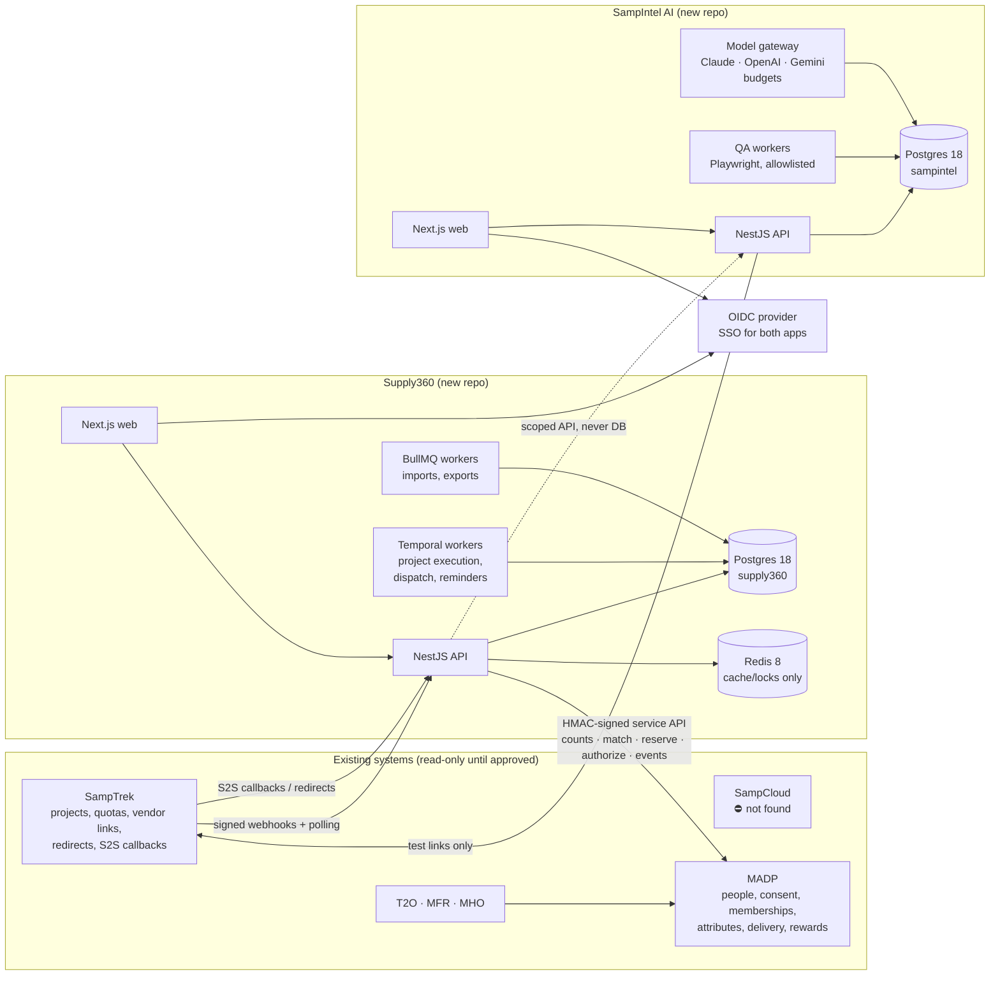

# Phase 0 · Proposed architecture and ADRs

## System context

Boundaries: Supply360 stores opaque `ref_…` audience references, counts and operational events only — never names,
contacts, answers or health data. SampIntel AI never sees refs or participation tokens. The two apps share no database
or credentials.

---

## ADR-001 · Build two new repositories (Decision D1 for Kunal)

**Context.** `kunalsharma-ai/supply360` and `SampAudience` overlap with the spec but carry excluded modules (finance,
CRM, quotes, invoices, portals, newsletters) and older stacks (Prisma 6 on MongoDB, Express, Tailwind 3).
**Decision (recommended).** New repos `supply360-platform` and `sampintel-ai` (names to confirm). Port proven ideas
(outbox worker, HMAC verification, idempotency tests, redirect handling) by rewriting, not copying modules.
**Consequence.** Kunal must create the two empty GitHub repos (this session cannot create repos). The old `supply360`
repo is left untouched.

## ADR-002 · Stack and pinned versions

Checked against npm `latest` and nodejs.org on 2026-11-25; re-checked at the start of each phase; pinned exactly;
no prereleases.

| Area                       | Choice                               | Version                                           |
| -------------------------- | ------------------------------------ | ------------------------------------------------- |
| Runtime                    | Node.js Active LTS                   | 26.13.1                                           |
| Package manager / monorepo | pnpm / Turborepo                     | 12.23.0 / 2.11.13                                 |
| Language                   | TypeScript strict                    | 7.0.2                                             |
| API                        | NestJS                               | 12.6.2                                            |
| Web                        | Next.js App Router / React           | 16.4.6 / 19.3.1                                   |
| Styling / UI               | Tailwind CSS / shadcn CLI / radix-ui | 4.3.5 / 4.23.1 / 1.8.1                            |
| Motion / charts / tables   | motion / ECharts / TanStack Table    | 14.14.0 / 6.1.0 / 9.3.1                           |
| Contracts                  | zod (OpenAPI generated from zod)     | 4.6.7                                             |
| ORM / migrations           | Drizzle ORM / drizzle-kit            | 0.45.4 / 0.31.11                                  |
| Workflows / jobs           | Temporal TS SDK / BullMQ             | 1.27.0 / 6.7.10                                   |
| Drivers                    | pg / ioredis                         | 8.23.1 / 6.1.0                                    |
| Auth crypto                | jose / argon2                        | 6.2.18 / 0.45.2                                   |
| Excel / QA browser         | ExcelJS / Playwright                 | 4.4.0 / 1.65.1                                    |
| Tests                      | Vitest                               | 5.1.2                                             |
| Telemetry                  | OpenTelemetry SDK                    | 0.301.2                                           |
| Datastores                 | PostgreSQL / Redis / Temporal server | 18 / 8 / latest stable image, verified in Phase 1 |

Rejected: **Prisma** — npm `latest` is `8.0.0-rc.35` (a release candidate). **@nestjs/swagger 12.1.2** — peer range
`typescript ^5.5 || ^6`, excludes TS 7; OpenAPI is generated from zod instead (same choice as MADP).

## ADR-003 · Workflow ownership: Temporal vs BullMQ

**Temporal** owns anything with long-lived state or timers: project execution per mode, batch dispatch loops, reminder
schedules (6/24/48 h are configuration, not defaults), review intervals, reconciliation runs, SampIntel execution
jobs with authorization/budget checks per step. **BullMQ** owns short, bounded, stateless jobs: project backfill
pages, export rendering, webhook delivery retries. No job type is owned by both. Postgres transactional
**outbox/inbox** feeds both; Redis is never the only copy of anything durable.

## ADR-004 · Data stores

Postgres is the source of truth for both apps (RLS on, see ADR-005). Redis for cache, rate limits and short locks.
**MongoDB is not adopted initially**: synthetic question/response documents fit Postgres JSONB with GIN indexes;
revisit only if measured need appears.

## ADR-005 · Tenant isolation

`tenant_id` on every row; Postgres row-level security with `app.tenant_id` set per transaction; tenant in every job
payload, cache key (`t:{tenant}:…`), event, export path and signed token. A cross-tenant test suite runs in CI.

## ADR-006 · Integration adapters with explicit modes

Each source has an adapter interface and two implementations: `FIXTURE` (local, labelled, deterministic) and `LIVE`
(real HTTP, enabled per tenant only after approval and a passing contract test). Mode is stored and shown on every
record, count and screen. Unknown capability → adapter reports `unsupported`, and the caller degrades safely (block
launch, pause, alert) instead of guessing.

## ADR-007 · Participation as an append-only event log

`participation_events` is append-only with `(tenant, source, source_event_id)` unique; current state is derived by a
deterministic transition function that tolerates retries, late and out-of-order events and records conflicts for
review. Start is never inferred from click. Synthetic events cannot enter this table (separate app and database).

## ADR-008 · Quota control and oversupply

Local quota cells with atomic reservations (`UPDATE … WHERE reserved + filled < target RETURNING`) and expiry; batch
size computed from the forecast but capped by reservations; MADP reservations mirror local ones. Quotas are never
relaxed by code; only a person with permission can change a target, audited.

## ADR-009 · Execution modes and the rule engine

One deterministic state machine for project lifecycle (`draft → validation_required → ready → scheduled → running ⇄
paused → target_reached → reconciling → closed`, `error` from any) and one policy engine evaluated before every
dispatch. Manual, semi-automatic and automatic are policies over the same engine. AI output is a _proposal_ object
that must pass the engine and, outside approved bounds, a human approval. Global and project kill switches checked
at every step.

## ADR-010 · Identity and access

OIDC for sign-in to both apps (self-hosted OIDC provider in local Docker Compose; tenant's IdP in production), MFA
required, RBAC with the 11 roles in §13 plus ABAC on project/panel/country/attribute. Service-to-service: OAuth2
client credentials between Supply360 and SampIntel; HMAC signing to MADP and SampTrek exactly as they specify.

## ADR-011 · AI model gateway

One gateway per app; providers Claude, OpenAI, Gemini behind one interface with structured (schema-validated)
outputs, timeouts, per-tenant and per-project budgets enforced before each call, model/version recorded on every
output. Survey content and user text are treated as untrusted input; no tool can run SQL or shell. The Copilot
translates requests into typed queries that the API authorizes like any other request.

## ADR-012 · SampIntel QA execution safety

Workers run Playwright in fresh isolated contexts against an allowlist from a valid authorization record; default is
test links / sandbox. Worker checks authorization scope, expiry, revocation, session cap, execution window and budget
before each session and each step. Stops on CAPTCHA, security challenge, unexpected navigation or rejection. No proxy
rotation, fingerprint spoofing or human-timing imitation. Outputs are labelled synthetic end to end.

## ADR-013 · API and live updates

REST + OpenAPI 3.1 from zod; RFC 9457 problem details; cursor paging; versioned events (`type@v1`); signed outbound
webhooks with timestamp + replay window; SSE for live fieldwork views.
